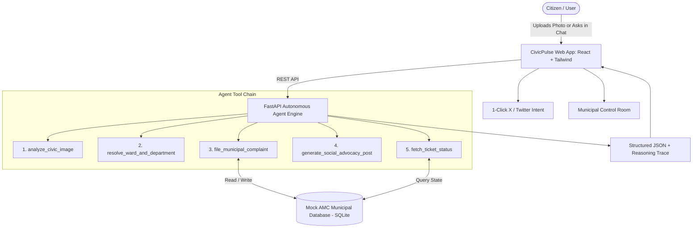

# CivicPulse AI 🏛️⚡
### Autonomous Civic Grievance Triage & Municipal Resolution Agent System
> **GovTech 2.0 Startup Platform** transforming citizen photos into tracked, audited, and publicly accountable municipal grievance tickets.

---

## 🚀 The Problem & Startup Vision
Reporting urban civic issues—potholes, garbage overflows, broken streetlights, waterlogging, or open manholes—traditionally requires navigating confusing municipal portals, determining ward boundaries, finding the correct department, and chasing officials for weeks. **Over 78% of citizens abandon the process before filing.**

**CivicPulse AI** solves this with an autonomous, tool-calling AI agent:
1. **A photo goes in.**
2. The agent visualizes and categorizes the hazard, assesses severity, and extracts EXIF GPS metadata.
3. Automatically maps the municipal ward, zone, and responsible municipal department.
4. Generates an official municipal ticket with a guaranteed SLA deadline.
5. Auto-drafts public accountability posts for **X (Twitter)** and **Instagram**, tagging official authorities.
6. Citizens can ask *"What's the status?"* anytime and receive real-time updates and SLA countdowns.

---

## 🛠️ The 5 Core Agent Tools

| Tool | Purpose | Schema Inputs | Outputs |
| :--- | :--- | :--- | :--- |
| `analyze_civic_image` | Multimodal vision & EXIF GPS extraction | `image_input`, `user_description` | Category, Severity, Confidence, EXIF Coords, Hazard tags |
| `resolve_ward_and_department` | AMC municipal routing matrix | `location_query`, `lat`, `lon`, `issue_category` | Zone, Ward No, Department, Ward Officer, SLA target |
| `file_municipal_complaint` | Grievance ticket creation in AMC SQLite DB | `issue_category`, `severity`, `address`, `ward_id`, etc. | Tracking ID (`AMC-2026-WZ-XXXXX`), SLA deadline, Officer |
| `generate_social_advocacy_post` | Public pressure & Twitter intent | `tracking_id` | Twitter Web Intent URL, Instagram caption, WhatsApp alert |
| `fetch_ticket_status` | Query live lifecycle & audit timeline | `tracking_id` | Current status, Audit events, SLA hours remaining, Escalation flag |

---

## 🏗️ System Architecture



---

## 🌟 Key Product Features

### 1. AI Filing Studio
- **Dual Input Modes**: Upload custom camera photos (with automatic EXIF GPS extraction) or test with 1-click curated Indian civic benchmarks (Mendeley & Roboflow datasets).
- **Live Tool Reasoning Trace**: Transparent, animated execution badges showing the cognitive reasoning of each tool call in real time.
- **Instant Grievance Slip**: Tracking ID, SLA countdown timer, and assigned engineer contact card.

### 2. Conversational Agent & Voice Assistant
- Multi-turn conversational interface powered by ReAct agent logic.
- Voice input (Web Speech API) and voice readout.
- Responds to natural queries like:
  - *"What's the status of ticket AMC-2026-WZ-88412?"*
  - *"Report a deep road crater on SG Highway"*
  - *"Why is my ticket taking so long? Can I escalate?"*

### 3. Track & Escalate (Citizen Portal)
- Live multi-stage visual timeline (`Registered` $\rightarrow$ `Inspected` $\rightarrow$ `In Progress` $\rightarrow$ `Resolved`).
- Real-time SLA countdown clock with breach detection.
- **1-Click Zonal Escalation**: If SLA is breached, citizens can escalate directly to the Zonal Deputy Municipal Commissioner.

### 4. Social Advocacy Studio
- Generates pre-formatted posts for **X (Twitter)** tagging `@AmdavadAMC`, `@MayorAmdavad`, and local corporators.
- **Direct 1-Click Twitter Web Intent Link**: Launches Twitter with pre-filled grievance details and official tags.
- Copy-ready captions for Instagram and WhatsApp community groups.

### 5. Municipal Control Room (Officer / Admin View)
- Real-time municipal KPIs: Total complaints, SLA compliance rate (%), Ward breakdown.
- Interactive Complaint Management Table: allows municipal officers to change status (`Inspected` $\rightarrow$ `In Progress` $\rightarrow$ `Resolved`) and add field remarks. Changes reflect immediately in the citizen tracker!

---

## 🏃 How to Run

### Method 1: 1-Click Startup (Recommended)
Double click `start.bat` in the project root:
```bash
./start.bat
```

### Method 2: Manual Startup

#### Step 1: Start Backend (FastAPI)
```bash
cd backend
python -m pip install -r requirements.txt
python run_backend.py
```
*Backend runs on `http://127.0.0.1:8000` with Swagger Docs at `/docs`.*

#### Step 2: Start Frontend (Vite + React)
```bash
cd frontend
npm install
npm run dev
```
*Frontend runs on `http://localhost:5173`.*

---

## 🧪 Verification & Automated Tests
To run the automated backend test suite:
```bash
cd backend
python test_agent.py
```
This tests all 5 tools, database seeding, tracking ID generation, SLA calculations, and conversational responses.

---

## 📚 Academic & Research Benchmarks Referenced
- [Mendeley Indian Urban Civic Issues Dataset](https://data.mendeley.com/datasets/zndzygc3p3/2) (Potholes, solid waste overflow, road debris)
- [Roboflow Pothole Object Detection Benchmark](https://public.roboflow.com/object-detection/pothole) (Labelled Indian road crater imagery)
- Ahmedabad Municipal Corporation (AMC) Open Data & Citizen Charter SLAs
